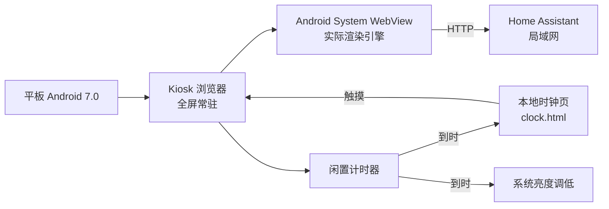

# 01 目标与整体结构

## 想要的效果

一台固定在墙上、常年通电的旧平板，承担这些职责：

- 开机后自动打开 Home Assistant，并保持登录；
- 平时显示 HA 概览 / 仪表盘；
- 一段时间无人操作后，亮度自动降到很低，并切到黑底时钟屏保；
- 有人触摸时立刻唤醒、恢复亮度、回到 HA 页面；
- 尽量不折腾：低功耗、低发热、长时间不崩。

## 结构

三层里最容易出问题的是 **WebView**：它既决定 HA 页面能不能正常渲染，也决定前端拿到哪一份 JS 包，进而决定 CPU 占用。

## 设备侧的关键约束

| 约束 | 影响 |
| --- | --- |
| Android 7.0 / API 24，未 root | 不能替换系统分区的文件，只能以「系统应用更新」方式升级 WebView |
| WebView 最高只到 119 | Home Assistant 2026.x 的现代前端要求 Chrome ≥ 131，硬件/系统存在天花板 |
| MIUI | 开机自启动被拦截，默认桌面会被系统抢回；见 [05](05-limits-and-rollback.md) |
| 1536×2048 高分屏 | GPU 填充压力大，减少无谓重绘收益明显 |
| 4 GB RAM | 内存不是瓶颈（实测可用 2.4 GB），但 WebView 内存占用会显著影响流畅度 |

## 建议的实施顺序

1. 先让 HA 能正常打开、保持登录（Kiosk 浏览器的 `startURL` 与 HTTP 认证设置）；
2. 升级 WebView，排除显示错乱 → [02](02-webview-upgrade.md)；
3. 量化性能，再决定是否调整 UA → [03](03-performance.md)；
4. 配置屏保与亮度 → [04](04-screensaver-power.md)；
5. 通读限制与回滚方案 → [05](05-limits-and-rollback.md)。

每一步都用 `adb` 验证，不要靠「看起来好像好了」来判断。
